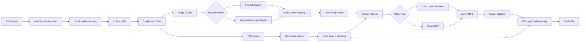

# MASTER PLAN — AUTO STORYBOARD → IMAGE → VOXSTYLE MOTION → VOICE → FINAL VIDEO

> Tài liệu thực thi dành cho coding agent giá rẻ như DeepSeek V4 Flash.  
> Agent không được tự thay đổi kiến trúc, không được bỏ qua test, không được tạo script dùng một lần ngoài cấu trúc dự án.

---

## 0. Mục tiêu cuối cùng

Xây dựng một tool chạy local trên Windows, nhận **kịch bản văn bản** và tự động tạo video hoàn chỉnh theo workflow:

1. Đọc kịch bản.
2. Dùng LLM qua **CLIProxyAPI/Cliproxy đã OAuth** để:
   - phân tích nội dung;
   - tự quyết định số scene hợp lý;
   - chia narration theo scene;
   - tạo prompt ảnh;
   - tạo prompt chuyển động;
   - giữ nhất quán nhân vật, bối cảnh và style.
3. Sinh ảnh bằng một trong hai provider:
   - **FlowKit**;
   - **Gemini 3.1 Image qua OAuth Antigravity Pro/local bridge**.
4. Biến ảnh thành motion kiểu editorial collage/Vox-style:
   - không chỉ pan/zoom Ken Burns;
   - nền, chủ thể, foreground, texture và chữ chuyển động độc lập;
   - hỗ trợ image-to-video qua FlowKit cho scene quan trọng;
   - luôn có local renderer dự phòng.
5. Dùng **OmniVoice đã cài trong venv riêng** để tạo voice.
6. Lấy thời lượng voice làm chuẩn để render từng scene.
7. Ghép scene, voice, subtitle, nhạc nền và hiệu ứng thành MP4 hoàn chỉnh.
8. Có checkpoint, resume, retry từng scene; hỏng một scene không làm mất toàn bộ project.

---

# 1. Nguyên tắc bắt buộc cho coding agent

## 1.1. Quy tắc thực thi

Agent phải:

1. Đọc toàn bộ file này trước khi sửa code.
2. Chỉ làm **một task ID tại một thời điểm**.
3. Trước mỗi task:
   - đọc `MASTER_PROGRESS.md`;
   - kiểm tra dependency;
   - chạy test hiện có.
4. Sau mỗi task:
   - cập nhật `MASTER_PROGRESS.md`;
   - ghi file đã sửa;
   - ghi lệnh test;
   - ghi kết quả test;
   - ghi blocker nếu có.
5. Không tự đổi framework hoặc kiến trúc.
6. Không hard-code:
   - đường dẫn venv;
   - port;
   - model ID;
   - token;
   - URL service;
   - thư mục output.
7. Không import trực tiếp OmniVoice vào orchestrator.
8. Không nhúng token OAuth vào source code.
9. Không gọi shell bằng chuỗi ghép từ input người dùng.
10. Không bỏ qua JSON Schema validation.
11. Không xóa asset cũ khi regenerate; phải tạo version mới.
12. Không tự động chuyển task sang `DONE` nếu chưa đạt acceptance criteria.
13. Không tạo UI trước khi CLI pipeline chạy end-to-end.
14. Không dùng MoviePy làm renderer chính.
15. Không dùng một ảnh phẳng rồi chỉ zoom/pan để gọi là VoxStyle.

## 1.2. Mẫu báo cáo sau mỗi task

Agent phải ghi vào `MASTER_PROGRESS.md` theo mẫu:

```md
## TASK P2-T03 — DONE

- Started:
- Finished:
- Files changed:
- Commands run:
- Tests:
- Result:
- Known limitations:
- Next eligible task:
```

Nếu thất bại:

```md
## TASK P2-T03 — BLOCKED

- Error:
- Reproduction command:
- Relevant log:
- Root-cause hypothesis:
- Safe next action:
```

---

# 2. Phạm vi MVP

## 2.1. MVP phải làm được

Đầu vào:

```text
script.txt
style preset
aspect ratio
voice profile
target FPS
image provider
motion quality tier
```

Đầu ra:

```text
final.mp4
project.json
storyboard.json
asset_manifest.json
render_manifest.json
subtitles.srt
logs/
scenes/
audio/
images/
```

MVP phải hỗ trợ:

- video ngang `16:9`;
- video dọc `9:16`;
- tiếng Việt;
- tự quyết định khoảng 4–20 scene tùy độ dài kịch bản;
- sinh lại riêng từng scene;
- chọn lại ảnh cho scene;
- voice-first timing;
- local VoxStyle motion renderer;
- optional FlowKit image-to-video;
- resume project sau khi dừng máy;
- CLI trước, UI sau.

## 2.2. Không thuộc MVP

Chưa làm trong MVP:

- multi-user SaaS;
- cloud deployment;
- mobile app;
- timeline editor kiểu Premiere;
- lip-sync nhân vật;
- real-time collaboration;
- auto upload TikTok/YouTube;
- training/fine-tune model;
- tự động lấy asset có bản quyền từ internet.

---

# 3. Kiến trúc được chốt

## 3.1. Kiến trúc tổng thể



## 3.2. Công nghệ bắt buộc

Backend/orchestrator:

- Python 3.11;
- FastAPI;
- Pydantic v2;
- SQLAlchemy;
- SQLite cho local MVP;
- `httpx` cho HTTP;
- `tenacity` cho retry;
- `structlog` hoặc logging JSON;
- `pytest`.

Render:

- FFmpeg;
- ffprobe;
- Pillow;
- OpenCV;
- NumPy.

Optional motion nâng cao:

- Remotion chỉ thêm sau khi local FFmpeg renderer chạy ổn;
- FlowKit I2V là quality tier, không phải đường duy nhất.

TTS:

- OmniVoice chạy trong venv hiện có;
- bọc thành process/service riêng.

## 3.3. Kiểu triển khai MVP

Chạy local bằng các process:

```text
1. CLIProxyAPI              đã cài
2. FlowKit backend/bridge   đã cài hoặc sẽ đấu nối
3. OmniVoice worker         dùng venv có sẵn
4. Main orchestrator        code mới
5. Optional Web UI          phase cuối
```

Không dùng Docker làm yêu cầu bắt buộc cho MVP Windows. Có thể thêm Docker sau.

---

# 4. Cấu trúc repository bắt buộc

```text
auto-storyboard-vox/
├─ app/
│  ├─ main.py
│  ├─ config.py
│  ├─ api/
│  │  ├─ projects.py
│  │  ├─ scenes.py
│  │  ├─ providers.py
│  │  └─ health.py
│  ├─ core/
│  │  ├─ orchestrator.py
│  │  ├─ state_machine.py
│  │  ├─ job_runner.py
│  │  ├─ retry_policy.py
│  │  └─ errors.py
│  ├─ models/
│  │  ├─ project.py
│  │  ├─ scene.py
│  │  ├─ asset.py
│  │  ├─ motion.py
│  │  └─ provider.py
│  ├─ schemas/
│  │  ├─ storyboard.schema.json
│  │  ├─ motion_plan.schema.json
│  │  ├─ asset_manifest.schema.json
│  │  └─ render_manifest.schema.json
│  ├─ providers/
│  │  ├─ base.py
│  │  ├─ llm/
│  │  │  └─ cliproxy.py
│  │  ├─ image/
│  │  │  ├─ flowkit.py
│  │  │  └─ antigravity.py
│  │  ├─ tts/
│  │  │  └─ omnivoice.py
│  │  └─ motion/
│  │     ├─ local_layers.py
│  │     └─ flowkit_i2v.py
│  ├─ services/
│  │  ├─ script_parser.py
│  │  ├─ storyboard_service.py
│  │  ├─ prompt_service.py
│  │  ├─ image_service.py
│  │  ├─ layer_service.py
│  │  ├─ tts_service.py
│  │  ├─ timing_service.py
│  │  ├─ motion_service.py
│  │  ├─ subtitle_service.py
│  │  ├─ render_service.py
│  │  └─ validation_service.py
│  ├─ render/
│  │  ├─ ffmpeg_builder.py
│  │  ├─ motion_compiler.py
│  │  ├─ filters.py
│  │  └─ transitions.py
│  └─ storage/
│     ├─ database.py
│     ├─ repositories.py
│     └─ asset_store.py
├─ workers/
│  └─ omnivoice_worker/
│     ├─ server.py
│     ├─ adapter.py
│     ├─ start_worker.ps1
│     └─ requirements-worker.txt
├─ prompts/
│  ├─ system_storyboard.md
│  ├─ scene_planner.md
│  ├─ image_prompt.md
│  ├─ motion_prompt.md
│  └─ repair_json.md
├─ presets/
│  ├─ editorial_collage.yaml
│  ├─ documentary.yaml
│  └─ minimal_motion.yaml
├─ scripts/
│  ├─ bootstrap.ps1
│  ├─ start_all.ps1
│  ├─ stop_all.ps1
│  ├─ health_check.ps1
│  └─ smoke_test.ps1
├─ tests/
│  ├─ fixtures/
│  ├─ unit/
│  ├─ integration/
│  └─ e2e/
├─ projects/
│  └─ .gitkeep
├─ .env.example
├─ pyproject.toml
├─ README.md
├─ MASTER_PLAN.md
└─ MASTER_PROGRESS.md
```

---

# 5. Cấu hình môi trường

## 5.1. `.env.example`

```dotenv
APP_ENV=local
APP_HOST=127.0.0.1
APP_PORT=8787
DATABASE_URL=sqlite:///./data/app.db
PROJECT_ROOT=./projects
LOG_LEVEL=INFO

FFMPEG_BIN=ffmpeg
FFPROBE_BIN=ffprobe

CLIPROXY_BASE_URL=http://127.0.0.1:8317/v1
CLIPROXY_API_KEY=local-placeholder
CLIPROXY_MODEL=deepseek-v4-flash
CLIPROXY_TIMEOUT_SECONDS=180

FLOWKIT_BASE_URL=http://127.0.0.1:8000
FLOWKIT_WS_URL=ws://127.0.0.1:8000/ws
FLOWKIT_TIMEOUT_SECONDS=900
FLOWKIT_ENABLED=true

ANTIGRAVITY_IMAGE_BASE_URL=http://127.0.0.1:8317
ANTIGRAVITY_IMAGE_MODEL=gemini-3.1-flash-image
ANTIGRAVITY_IMAGE_ENABLED=true

OMNIVOICE_VENV_PYTHON=C:/PATH/TO/OMNIVOICE/venv/Scripts/python.exe
OMNIVOICE_WORKER_HOST=127.0.0.1
OMNIVOICE_WORKER_PORT=8791
OMNIVOICE_MODEL_PATH=C:/PATH/TO/OMNIVOICE/MODEL
OMNIVOICE_DEFAULT_LANGUAGE=vi
OMNIVOICE_TIMEOUT_SECONDS=600

DEFAULT_ASPECT_RATIO=16:9
DEFAULT_FPS=30
DEFAULT_WIDTH=1920
DEFAULT_HEIGHT=1080
DEFAULT_IMAGE_PROVIDER=flowkit
DEFAULT_MOTION_TIER=local
DEFAULT_STYLE_PRESET=editorial_collage
```

## 5.2. Startup discovery bắt buộc

Do đường dẫn thực tế chưa được cung cấp, Phase 0 phải tự phát hiện:

- executable CLIProxyAPI;
- port CLIProxy;
- endpoint models;
- FlowKit backend URL;
- FlowKit health endpoint;
- FlowKit image generation contract;
- FlowKit image-to-video contract;
- đường dẫn Python trong OmniVoice venv;
- command hiện tại người dùng đang dùng để sinh WAV;
- FFmpeg và ffprobe.

Discovery chỉ được ghi config, không được sửa các tool đã cài.

---

# 6. Mô hình dữ liệu cốt lõi

## 6.1. `Project`

```json
{
  "project_id": "prj_20260803_001",
  "title": "Example",
  "status": "INGESTED",
  "script_source": "input/script.txt",
  "script_hash": "sha256",
  "aspect_ratio": "16:9",
  "fps": 30,
  "style_preset": "editorial_collage",
  "image_provider": "flowkit",
  "motion_tier": "local",
  "voice_profile_id": "voice_vi_01",
  "created_at": "ISO-8601",
  "updated_at": "ISO-8601"
}
```

## 6.2. `Storyboard`

```json
{
  "project_id": "prj_20260803_001",
  "summary": "Tóm tắt nội dung",
  "target_duration_seconds": 60,
  "style_anchor": {
    "visual_language": "editorial paper collage",
    "palette": ["off-white", "black", "red accent"],
    "texture": ["paper grain", "halftone"],
    "typography": "bold editorial sans",
    "continuity_rules": []
  },
  "characters": [],
  "locations": [],
  "scenes": []
}
```

## 6.3. `Scene`

```json
{
  "scene_id": "scene_001",
  "order": 1,
  "script_span": {
    "start_char": 0,
    "end_char": 130
  },
  "narration_text": "Nội dung voice của scene.",
  "purpose": "hook",
  "estimated_duration_seconds": 5.2,
  "actual_voice_duration_ms": null,
  "visual_summary": "Mô tả hình ảnh",
  "image_prompt": "Prompt chi tiết",
  "negative_constraints": [
    "no embedded text",
    "no watermark",
    "no duplicate limbs"
  ],
  "motion_prompt": "Prompt chuyển động",
  "motion_template": "subject_enter_headline_pop",
  "transition_out": "paper_wipe",
  "status": "PLANNED",
  "selected_image_asset_id": null,
  "selected_motion_asset_id": null
}
```

## 6.4. `SceneAssetPackage`

Mỗi scene ưu tiên sinh asset theo lớp ngay từ đầu:

```json
{
  "scene_id": "scene_001",
  "assets": [
    {
      "role": "background",
      "path": "images/scene_001/background.png",
      "alpha": false
    },
    {
      "role": "subject",
      "path": "images/scene_001/subject.png",
      "alpha": true
    },
    {
      "role": "foreground",
      "path": "images/scene_001/foreground.png",
      "alpha": true
    },
    {
      "role": "texture",
      "path": "images/scene_001/texture.png",
      "alpha": true
    }
  ],
  "text_overlays": [
    {
      "text": "DÒNG CHỮ CHÍNH",
      "placement": "top_left"
    }
  ]
}
```

## 6.5. `MotionPlan`

```json
{
  "scene_id": "scene_001",
  "duration_ms": 5320,
  "fps": 30,
  "canvas": {
    "width": 1920,
    "height": 1080
  },
  "camera": {
    "x": [[0, 0], [5320, -12]],
    "y": [[0, 0], [5320, 5]],
    "scale": [[0, 1.0], [5320, 1.025]]
  },
  "layers": [
    {
      "id": "background",
      "asset_role": "background",
      "z": 0,
      "transform": {
        "x": [[0, 0], [5320, -20]],
        "scale": [[0, 1.0], [5320, 1.04]]
      }
    },
    {
      "id": "subject",
      "asset_role": "subject",
      "z": 20,
      "transform": {
        "x": [[0, -100], [500, 0], [5320, 14]],
        "y": [[0, 20], [500, 0], [5320, -8]],
        "scale": [[0, 0.92], [500, 1.0], [5320, 1.035]],
        "rotation_deg": [[0, -2.0], [500, 0], [5320, 1.0]]
      }
    }
  ],
  "text_animations": [],
  "effects": [
    {
      "type": "paper_grain",
      "amount": 0.12
    }
  ]
}
```

---

# 7. Quy tắc tự chia scene

LLM không được tự chia scene hoàn toàn tùy ý. Orchestrator phải đưa constraint.

## 7.1. Heuristic mặc định

```text
Tốc độ narration tiếng Việt mặc định: 2.7–3.3 từ/giây.
Scene tối thiểu: 2.5 giây.
Scene lý tưởng: 4–7 giây.
Scene tối đa: 10 giây.
Mỗi scene nên chứa một ý hình ảnh chính.
Không cắt giữa tên riêng, con số hoặc một câu đang dang dở.
Hook 3–6 giây.
Scene kết luận 4–8 giây.
```

## 7.2. Ước lượng số scene

```python
estimated_voice_seconds = word_count / target_words_per_second
base_scene_count = round(estimated_voice_seconds / target_scene_seconds)
scene_count = clamp(base_scene_count, min=4, max=20)
```

Giá trị mặc định:

```text
target_words_per_second = 3.0
target_scene_seconds = 5.5
```

LLM được phép lệch khoảng ±25% nếu cấu trúc nội dung yêu cầu.

## 7.3. Hai vòng LLM

Vòng 1 — Planner:

- phân tích ý;
- đề xuất scene boundaries;
- không tạo prompt ảnh quá dài.

Vòng 2 — Scene Expander:

- tạo prompt ảnh;
- motion grammar;
- continuity constraints;
- text overlay;
- transition.

Nếu JSON lỗi:

1. parse;
2. validate;
3. gửi lỗi schema cho prompt `repair_json.md`;
4. retry tối đa 2 lần;
5. nếu vẫn lỗi, dừng task và ghi log.

---

# 8. Provider contracts

## 8.1. LLM Provider

```python
class LLMProvider(Protocol):
    async def generate_json(
        self,
        *,
        system_prompt: str,
        user_prompt: str,
        schema: dict,
        temperature: float,
        request_id: str,
    ) -> dict:
        ...
```

`CliproxyLLMProvider`:

- dùng OpenAI-compatible API nếu endpoint hỗ trợ;
- model lấy từ config;
- timeout 180 giây;
- retry 429, 500, 502, 503, 504;
- không retry lỗi validation bằng cùng prompt;
- log request ID, model, elapsed time;
- không log token hoặc credential.

## 8.2. Image Provider

```python
class ImageProvider(Protocol):
    async def generate(
        self,
        request: ImageGenerationRequest,
    ) -> ImageGenerationResult:
        ...

    async def health(self) -> ProviderHealth:
        ...

    async def capabilities(self) -> ProviderCapabilities:
        ...
```

Yêu cầu chung:

- text-to-image;
- image-to-image;
- reference image;
- aspect ratio;
- output path;
- prompt lineage;
- provider task ID;
- polling;
- cancellation nếu provider hỗ trợ.

### FlowKit adapter

Không cho orchestrator thao tác trực tiếp browser token.

Adapter chỉ gọi local FlowKit service.

Phải có:

- health check;
- submit job;
- poll status;
- download/copy result;
- timeout;
- circuit breaker;
- cooldown;
- queue concurrency mặc định `1`.

### Antigravity image adapter

Không được giả định endpoint.

Phase discovery phải:

1. gọi endpoint models/capabilities;
2. tìm route image generation;
3. thử một ảnh 512–1024 px;
4. ghi lại request/response contract đã redacted;
5. viết adapter theo contract thực tế.

Nếu CLIProxy không expose image generation ổn định:

- đánh dấu provider `UNAVAILABLE`;
- không phá workflow;
- dùng FlowKit làm default;
- giữ interface để bổ sung sau.

## 8.3. TTS Provider

```python
class TTSProvider(Protocol):
    async def synthesize(
        self,
        request: TTSRequest,
    ) -> TTSResult:
        ...
```

Request:

```json
{
  "segment_id": "scene_001",
  "text": "Nội dung",
  "language": "vi",
  "voice_profile_id": "voice_vi_01",
  "reference_audio_path": "voices/ref.wav",
  "seed": 42,
  "output_path": "audio/scene_001.wav"
}
```

Result:

```json
{
  "wav_path": "audio/scene_001.wav",
  "duration_ms": 5320,
  "sample_rate": 24000,
  "channels": 1,
  "provider": "omnivoice"
}
```

## 8.4. Motion Provider

```python
class MotionProvider(Protocol):
    async def render(
        self,
        request: MotionRenderRequest,
    ) -> MotionRenderResult:
        ...
```

Hai provider:

```text
local_layers
flowkit_i2v
```

Routing mặc định:

```text
normal scene      -> local_layers
hero scene        -> flowkit_i2v nếu bật
provider lỗi      -> local_layers fallback
```

---

# 9. OmniVoice worker

## 9.1. Lý do tách worker

Không import OmniVoice trực tiếp vào app chính vì:

- venv riêng;
- PyTorch/CUDA dependency riêng;
- model load nặng;
- dễ xung đột package;
- cần preload model một lần.

## 9.2. API local tối thiểu

```text
GET  /health
GET  /voices
POST /synthesize
POST /warmup
```

## 9.3. Worker startup

`workers/omnivoice_worker/start_worker.ps1`:

```powershell
$python = $env:OMNIVOICE_VENV_PYTHON

if (-not (Test-Path $python)) {
    Write-Error "OmniVoice Python not found: $python"
    exit 1
}

& $python "$PSScriptRoot/server.py"
```

## 9.4. Discovery OmniVoice

Agent phải tìm cách gọi OmniVoice hiện tại theo thứ tự:

1. kiểm tra script inference có sẵn;
2. kiểm tra package import;
3. chạy command hiện tại với câu test;
4. lấy WAV;
5. dùng ffprobe lấy duration;
6. bọc command ổn định nhất vào adapter;
7. không sửa thư viện gốc nếu không cần.

## 9.5. Chuẩn hóa tiếng Việt

Trước TTS:

- chuẩn hóa khoảng trắng;
- chuyển ký hiệu `%`, `+`, `&`;
- đọc số;
- xử lý ngày tháng;
- xử lý URL;
- xử lý viết tắt theo dictionary;
- giữ nguyên tên riêng theo override list.

Tạo:

```text
config/pronunciation_vi.json
```

---

# 10. Image asset strategy

## 10.1. Không yêu cầu AI nhúng chữ vào ảnh

Ảnh nền không chứa text chính vì AI dễ sai chữ.

Chữ headline, label, số liệu phải render local bằng FFmpeg/Pillow/Remotion.

## 10.2. Ưu tiên sinh theo lớp

Một scene tạo tối đa:

```text
background.png
subject.png
foreground.png
texture.png
reference_composite.png
```

Có hai chiến lược:

### Strategy A — Direct layer generation

Yêu cầu provider tạo từng lớp:

- background không có người;
- subject trên nền trơn hoặc alpha nếu hỗ trợ;
- foreground decorations;
- texture riêng.

### Strategy B — Composite then segment

Nếu provider chỉ trả ảnh hoàn chỉnh:

1. lưu `composite.png`;
2. dùng `rembg` hoặc segmentation adapter;
3. tạo `subject_rgba.png`;
4. inpaint/regen background nếu cần;
5. validation alpha mask.

MVP ưu tiên Strategy A, Strategy B là fallback.

## 10.3. Prompt ảnh chuẩn

Prompt phải gồm:

```text
SCENE PURPOSE
SUBJECT
ACTION
ENVIRONMENT
COMPOSITION
CAMERA
LIGHTING
EDITORIAL COLLAGE STYLE
COLOR PALETTE
TEXT-SAFE AREA
CONTINUITY RULES
OUTPUT LAYER ROLE
NEGATIVE CONSTRAINTS
```

Ví dụ role `background`:

```text
Generate only the background plate. No people, no text, no logos.
Editorial paper-collage documentary look, off-white newsprint,
subtle halftone, torn paper edges, strong depth layers,
leave the upper-left 25% visually calm for headline overlay.
```

---

# 11. VoxStyle motion system

Tên nội bộ nên dùng:

```text
editorial_collage_motion
```

Không dùng “Vox” làm tên sản phẩm thương mại.

## 11.1. Mục tiêu

Scene phải có ít nhất ba chuyển động độc lập:

1. background/camera;
2. subject;
3. text/foreground/effect.

Một scene bị coi là Ken Burns nếu:

- chỉ có một bitmap;
- toàn frame chỉ scale + translate;
- không có layer độc lập;
- không có motion event cục bộ.

## 11.2. Motion grammar

Các template MVP:

```text
01_subject_slide_headline_pop
02_subject_float_label_reveal
03_map_pan_marker_pulse
04_before_after_split
05_stat_number_count
06_timeline_cards
07_document_highlight
08_photo_stack_shuffle
09_cutout_parallax
10_quote_card
11_object_zoom_texture_wipe
12_conclusion_lockup
```

## 11.3. Hiệu ứng MVP

Local renderer phải có:

- independent parallax;
- spring-like entrance;
- word pop;
- line wipe;
- mask reveal;
- paper tear transition;
- halftone pulse;
- film grain;
- subtle jitter;
- shadow offset;
- photo stack;
- marker/highlight animation;
- counter animation;
- background texture drift.

## 11.4. Biên độ chuyển động

Để tránh motion quá mạnh:

```text
background scale: 1.00 → tối đa 1.06
subject drift: tối đa 4% chiều rộng
subject rotation: ±3 độ
foreground drift: tối đa 6% chiều rộng
camera pan: tối đa 3% canvas
jitter: 0.2–1.2 px
```

## 11.5. Local renderer

Input:

```text
SceneAssetPackage
MotionPlan
voice_duration_ms
fps
resolution
```

Output:

```text
scenes/scene_001/local_motion.mp4
```

Renderer phải:

1. compile MotionPlan thành FFmpeg filter graph;
2. dùng argument array, không dùng `shell=True`;
3. render video silent đúng duration;
4. validate resolution, FPS, duration;
5. lưu command vào render manifest.

## 11.6. FlowKit I2V

Dùng cho:

- hook;
- hero shot;
- scene cần chuyển động người/vật thật;
- scene có camera motion phức tạp.

Prompt I2V phải quy định:

- chủ thể nào chuyển động;
- phần nào giữ tĩnh;
- camera motion;
- cấm morphing;
- cấm text biến dạng;
- thời lượng;
- không đổi nhân vật;
- không thêm vật thể.

Sau khi nhận I2V:

- normalize FPS;
- crop/scale;
- trim hoặc loop hợp lý;
- overlay typography và texture local;
- match voice duration.

---

# 12. Voice-first timing

## 12.1. Thứ tự bắt buộc

```text
Storyboard approved
→ generate TTS per scene
→ measure actual duration
→ update Scene.actual_voice_duration_ms
→ build MotionPlan
→ render exact frame count
```

Không render scene trước rồi ép voice chạy nhanh/chậm quá mức.

## 12.2. Thời lượng scene

```python
scene_duration_ms = (
    voice_duration_ms
    + lead_in_ms
    + lead_out_ms
)
```

Mặc định:

```text
lead_in_ms = 120
lead_out_ms = 220
```

## 12.3. Số frame

```python
frame_count = round(scene_duration_ms / 1000 * fps)
```

## 12.4. Điều chỉnh sai lệch

Cho phép:

```text
video/audio lệch tối đa: 1 frame
```

Nếu clip I2V ngắn hơn:

1. ưu tiên optical-safe loop hoặc local hold;
2. speed change tối đa ±8%;
3. không kéo voice;
4. nếu vẫn thiếu, chuyển local renderer fallback.

---

# 13. Subtitle

MVP tạo subtitle từ narration text.

## 13.1. Fallback timing

Nếu OmniVoice không trả word timing:

- chia theo cụm dấu câu;
- phân bổ thời gian theo trọng số ký tự;
- minimum subtitle duration 700 ms;
- maximum 2 dòng;
- tối đa khoảng 42 ký tự/dòng tùy tỉ lệ.

## 13.2. Optional alignment

Sau MVP có thể thêm:

- faster-whisper;
- WhisperX;
- stable-ts.

Không được để forced alignment chặn render MVP.

---

# 14. State machine

```text
INGESTED
→ SCRIPT_ANALYZED
→ STORYBOARD_DRAFTED
→ STORYBOARD_VALIDATED
→ STORYBOARD_APPROVED
→ VOICE_GENERATING
→ VOICE_READY
→ IMAGES_GENERATING
→ IMAGES_READY
→ LAYERS_READY
→ MOTION_PLANNED
→ SCENES_RENDERING
→ SCENES_READY
→ FINAL_RENDERING
→ VALIDATING
→ COMPLETED
```

Scene state:

```text
PLANNED
→ VOICE_READY
→ IMAGE_SUBMITTED
→ IMAGE_READY
→ LAYERS_READY
→ MOTION_READY
→ RENDERED
→ VALIDATED
```

Error state:

```text
FAILED_RETRYABLE
FAILED_PERMANENT
CANCELLED
```

Mỗi state transition phải được ghi DB và log.

---

# 15. Cache và idempotency

## 15.1. Hash key

Asset generation cache key:

```text
sha256(
  provider
  + model
  + prompt
  + negative_prompt
  + reference_asset_hashes
  + aspect_ratio
  + seed
  + provider_parameters
)
```

TTS cache key:

```text
sha256(
  text_normalized
  + voice_profile
  + language
  + reference_audio_hash
  + seed
  + tts_parameters
)
```

## 15.2. Regenerate

Khi regenerate scene:

- không ghi đè asset cũ;
- tạo attempt mới;
- cập nhật selected asset;
- scene downstream trở thành stale;
- chỉ rerender phần bị ảnh hưởng.

Ví dụ:

```text
đổi prompt ảnh
→ image stale
→ layers stale
→ motion render stale
→ final render stale
→ voice không stale
```

---

# 16. API và CLI MVP

## 16.1. CLI

```powershell
python -m app.cli doctor
python -m app.cli create-project --script input.txt
python -m app.cli plan --project PROJECT_ID
python -m app.cli generate-voice --project PROJECT_ID
python -m app.cli generate-images --project PROJECT_ID
python -m app.cli render-scenes --project PROJECT_ID
python -m app.cli render-final --project PROJECT_ID
python -m app.cli run --project PROJECT_ID
python -m app.cli retry-scene --project PROJECT_ID --scene scene_004
python -m app.cli status --project PROJECT_ID
```

## 16.2. FastAPI endpoints

```text
GET  /health
GET  /providers/health
POST /projects
GET  /projects/{project_id}
POST /projects/{project_id}/plan
POST /projects/{project_id}/run
POST /projects/{project_id}/cancel
GET  /projects/{project_id}/status

GET  /projects/{project_id}/scenes
POST /projects/{project_id}/scenes/{scene_id}/regenerate-image
POST /projects/{project_id}/scenes/{scene_id}/rerender
POST /projects/{project_id}/render-final
```

---

# 17. Validation

## 17.1. Storyboard validation

- scene IDs unique;
- scene order liên tục;
- script spans không overlap sai;
- toàn bộ script được phủ;
- narration không rỗng;
- duration hợp lý;
- prompt có style anchor;
- không vượt max scene;
- JSON đúng schema.

## 17.2. Image validation

- file tồn tại;
- decode được;
- đúng aspect ratio sai số cho phép;
- không phải ảnh rỗng;
- kích thước tối thiểu;
- alpha mask hợp lệ nếu là layer;
- không có file 0 byte.

Optional:

- image similarity;
- OCR để phát hiện text sai;
- face consistency.

## 17.3. Audio validation

- WAV tồn tại;
- duration > 0;
- sample rate hợp lệ;
- không clipping nghiêm trọng;
- loudness normalize;
- không có silence toàn file.

## 17.4. Scene validation

- MP4 decode được;
- đúng resolution;
- đúng FPS;
- đúng pixel format;
- duration lệch không quá một frame;
- không có black frame kéo dài ngoài chủ ý;
- audio sync đúng.

## 17.5. Final validation

Dùng ffprobe kiểm tra:

```text
video codec
audio codec
resolution
FPS
duration
stream count
pixel format
audio sample rate
```

Output mặc định:

```text
H.264
AAC
yuv420p
30 FPS
faststart
```

---

# 18. Logging

Mỗi log record cần:

```json
{
  "timestamp": "ISO-8601",
  "level": "INFO",
  "project_id": "prj_x",
  "scene_id": "scene_001",
  "task_id": "P4-T02",
  "provider": "flowkit",
  "request_id": "uuid",
  "event": "image_generation_submitted",
  "elapsed_ms": 0
}
```

Không log:

- OAuth token;
- cookie;
- API key;
- reference voice raw data;
- full provider auth response.

---

# 19. Phase execution plan

---

## PHASE 0 — DISCOVERY VÀ HEALTH CHECK

### P0-T01 — Khởi tạo repository

**Dependency:** không.

**Thực hiện:**

- tạo cây thư mục chuẩn;
- tạo `pyproject.toml`;
- tạo `.env.example`;
- tạo `MASTER_PROGRESS.md`;
- thêm formatter/linter/test config;
- thêm `.gitignore`.

**Acceptance criteria:**

```powershell
python -m pytest
```

chạy được dù chưa có test thực tế.

---

### P0-T02 — Viết system doctor

**Dependency:** P0-T01.

Tạo command:

```powershell
python -m app.cli doctor
```

Doctor kiểm tra:

- Python version;
- FFmpeg;
- ffprobe;
- writable project directory;
- CLIProxy health;
- CLIProxy model list;
- FlowKit health;
- OmniVoice venv Python;
- OmniVoice import hoặc inference command;
- GPU/CUDA info nếu có.

Output machine-readable:

```json
{
  "cliproxy": {"status": "ok"},
  "flowkit": {"status": "ok"},
  "omnivoice": {"status": "ok"},
  "ffmpeg": {"status": "ok"}
}
```

**Acceptance criteria:**

- lỗi một provider không làm doctor crash;
- exit code `0` nếu core dependency đủ;
- exit code khác `0` nếu FFmpeg hoặc Python không hợp lệ;
- lưu `doctor_report.json`.

---

### P0-T03 — Probe CLIProxy

**Dependency:** P0-T02.

Thực hiện:

- gọi `/v1/models`;
- test một chat completion;
- yêu cầu output JSON đơn giản;
- xác định model alias tốt nhất;
- ghi capability report;
- không sửa CLIProxy.

**Acceptance criteria:**

- có `config/discovered/cliproxy.json`;
- chat completion trả JSON parse được;
- credential bị redacted trong log.

---

### P0-T04 — Probe FlowKit

**Dependency:** P0-T02.

Thực hiện:

- tìm health endpoint;
- đọc local API contract hoặc source đã cài;
- test một image job nhỏ;
- ghi submit/poll/result flow;
- test browser bridge availability;
- xác định concurrency/cooldown.

**Acceptance criteria:**

- có `config/discovered/flowkit.json`;
- tạo được ít nhất một ảnh test hoặc ghi blocker có reproduction rõ;
- adapter contract được ghi lại.

---

### P0-T05 — Probe Antigravity image route

**Dependency:** P0-T03.

Thực hiện:

- kiểm tra CLIProxy/local Antigravity endpoint;
- tìm model image;
- test text-to-image;
- lưu response shape đã redacted.

**Acceptance criteria:**

Một trong hai trạng thái hợp lệ:

```text
AVAILABLE
UNAVAILABLE_WITH_REASON
```

Không được làm project fail nếu unavailable.

---

### P0-T06 — Probe OmniVoice venv

**Dependency:** P0-T02.

Thực hiện:

- xác định Python path;
- xác định inference entrypoint;
- sinh câu test tiếng Việt;
- lấy WAV;
- đo duration;
- ghi command ổn định.

**Acceptance criteria:**

- sinh được `tests/fixtures/omnivoice_probe.wav`;
- ffprobe đọc được;
- có `config/discovered/omnivoice.json`.

---

## PHASE 1 — NỀN TẢNG ORCHESTRATOR

### P1-T01 — Config system

**Dependency:** Phase 0.

- Pydantic Settings;
- load `.env`;
- validate path;
- default config;
- redacted dump.

**Acceptance criteria:**

- unit test config;
- missing secret không in ra log;
- path Windows được xử lý đúng.

---

### P1-T02 — Database và repository layer

**Dependency:** P1-T01.

Tạo bảng:

```text
projects
scenes
assets
provider_jobs
render_attempts
state_events
voice_profiles
```

**Acceptance criteria:**

- migration hoặc create schema;
- CRUD test;
- transaction rollback test;
- SQLite chạy local.

---

### P1-T03 — Asset store

**Dependency:** P1-T02.

Quy ước thư mục project:

```text
projects/{project_id}/
├─ input/
├─ manifests/
├─ audio/
├─ images/
├─ layers/
├─ scenes/
├─ final/
└─ logs/
```

**Acceptance criteria:**

- path traversal bị chặn;
- atomic write;
- SHA-256 metadata;
- versioned assets.

---

### P1-T04 — State machine

**Dependency:** P1-T02.

- validate transition;
- record state event;
- scene state độc lập;
- resume.

**Acceptance criteria:**

- invalid transition bị từ chối;
- test restart/resume bằng SQLite;
- hỏng scene không đổi các scene đã hoàn thành.

---

### P1-T05 — Job runner

**Dependency:** P1-T04.

MVP dùng in-process async queue, chưa cần Redis/Celery.

- max concurrency theo provider;
- cancellation;
- retry;
- timeout;
- heartbeat.

**Acceptance criteria:**

- test retry;
- test cancellation;
- test one failed job không dừng queue;
- process restart đọc lại pending state.

---

## PHASE 2 — CLIPROXY LLM VÀ STORYBOARD

### P2-T01 — Base provider interfaces

**Dependency:** P1.

Tạo protocol/interface cho:

- LLM;
- image;
- TTS;
- motion.

**Acceptance criteria:**

- fake providers cho test;
- provider registry;
- capability discovery.

---

### P2-T02 — Cliproxy LLM adapter

**Dependency:** P0-T03, P2-T01.

- OpenAI-compatible client;
- timeout;
- retry;
- JSON parse;
- request ID;
- model config;
- health.

**Acceptance criteria:**

- integration test với CLIProxy local;
- mock test 429;
- mock test malformed JSON;
- no credential log.

---

### P2-T03 — Storyboard JSON Schema

**Dependency:** P2-T01.

Schema phải bắt buộc:

- project summary;
- style anchor;
- characters;
- locations;
- scenes;
- narration;
- visual prompt;
- motion template;
- duration estimate;
- continuity.

**Acceptance criteria:**

- valid fixture pass;
- invalid fixture fail;
- scene count rule test.

---

### P2-T04 — Prompt pack

**Dependency:** P2-T03.

Tạo:

```text
prompts/system_storyboard.md
prompts/scene_planner.md
prompts/image_prompt.md
prompts/motion_prompt.md
prompts/repair_json.md
```

System prompt bắt buộc yêu cầu:

- chỉ trả JSON;
- tuân thủ schema;
- không markdown;
- không tự bịa provider;
- narration-first;
- scene 4–7 giây;
- motion không chỉ Ken Burns;
- chữ render local;
- nhất quán nhân vật.

**Acceptance criteria:**

- prompt snapshot tests;
- không chứa model ID hard-coded;
- style preset inject được.

---

### P2-T05 — Script analysis service

**Dependency:** P2-T02, P2-T04.

Pipeline:

1. normalize script;
2. word count;
3. estimate duration;
4. estimate scene count;
5. planner call;
6. schema validate;
7. repair call nếu lỗi;
8. persist.

**Acceptance criteria:**

- fixture script ngắn;
- fixture script 60 giây;
- fixture script dài;
- coverage toàn script;
- output deterministic ở temperature thấp.

---

### P2-T06 — Storyboard CLI

**Dependency:** P2-T05.

```powershell
python -m app.cli create-project --script sample.txt
python -m app.cli plan --project PROJECT_ID
```

**Acceptance criteria:**

- tạo `storyboard.json`;
- DB có scenes;
- status đúng;
- chạy lần hai không duplicate nếu input không đổi.

---

## PHASE 3 — OMNIVOICE WORKER

### P3-T01 — Worker skeleton

**Dependency:** P0-T06, P2-T01.

FastAPI worker riêng chạy bằng OmniVoice venv.

**Acceptance criteria:**

```text
GET /health = ok
POST /warmup = model loaded
```

---

### P3-T02 — OmniVoice adapter

**Dependency:** P3-T01.

Bọc inference thực tế đã discovery.

**Acceptance criteria:**

- sinh WAV tiếng Việt;
- model chỉ load một lần;
- request thứ hai không reload model;
- lỗi input trả JSON rõ.

---

### P3-T03 — Voice profiles

**Dependency:** P3-T02.

Voice profile:

```json
{
  "voice_profile_id": "voice_vi_01",
  "reference_audio_path": "voices/ref.wav",
  "language": "vi",
  "seed": 42,
  "speed": 1.0
}
```

**Acceptance criteria:**

- validate file;
- hash reference;
- không copy đè;
- list profile.

---

### P3-T04 — Vietnamese normalization

**Dependency:** P3-T02.

**Acceptance criteria:**

Test cho:

- số tiền;
- phần trăm;
- ngày;
- URL;
- từ viết tắt;
- dấu câu;
- tên riêng override.

---

### P3-T05 — TTS scene pipeline

**Dependency:** P2-T06, P3-T04.

- generate per scene;
- cache;
- duration;
- loudness normalization;
- persist result.

**Acceptance criteria:**

- tất cả scene có WAV;
- actual duration cập nhật;
- rerun dùng cache;
- thay narration chỉ regenerate scene đó.

---

## PHASE 4 — IMAGE PROVIDERS

### P4-T01 — Image request/result schemas

**Dependency:** P2-T01.

Hỗ trợ:

- prompt;
- role;
- reference images;
- aspect;
- seed;
- candidate count;
- output path.

---

### P4-T02 — FlowKit adapter

**Dependency:** P0-T04, P4-T01.

- submit;
- poll;
- timeout;
- circuit breaker;
- download;
- copy asset;
- job metadata.

**Acceptance criteria:**

- tạo một ảnh thật;
- timeout test;
- browser bridge unavailable test;
- concurrency = 1 mặc định.

---

### P4-T03 — Antigravity image adapter

**Dependency:** P0-T05, P4-T01.

Nếu provider AVAILABLE:

- implement theo discovered contract;
- normalize result.

Nếu UNAVAILABLE:

- adapter health trả unavailable;
- unit tests vẫn pass;
- provider registry fallback FlowKit.

**Acceptance criteria:**

- không làm app crash;
- provider switching bằng config.

---

### P4-T04 — Scene image prompt builder

**Dependency:** P2-T05.

Sinh prompt theo role:

```text
background
subject
foreground
texture
reference composite
```

**Acceptance criteria:**

- không yêu cầu AI tạo chữ;
- prompt có text-safe area;
- prompt có continuity;
- prompt role-specific.

---

### P4-T05 — Image generation service

**Dependency:** P4-T02/P4-T03, P4-T04.

- per-scene jobs;
- candidate versioning;
- selected asset;
- cache;
- retry;
- fallback.

**Acceptance criteria:**

- generate toàn project;
- fail một scene không mất scene khác;
- retry scene;
- select candidate.

---

## PHASE 5 — LAYER PREPARATION

### P5-T01 — Layer package validator

**Dependency:** P4-T05.

- validate image;
- aspect;
- alpha;
- role;
- dimensions.

---

### P5-T02 — Direct layer workflow

**Dependency:** P5-T01.

Nếu provider trả đủ lớp:

- normalize canvas;
- trim alpha;
- preserve metadata;
- create preview composite.

**Acceptance criteria:**

- preview composite render đúng;
- layer alignment đúng;
- asset manifest đầy đủ.

---

### P5-T03 — Segmentation fallback

**Dependency:** P5-T01.

Thêm adapter `rembg` hoặc segmentation tương đương.

- composite → subject RGBA;
- background fallback;
- mask cleanup;
- edge feather.

**Acceptance criteria:**

- fixture người/vật tạo alpha hợp lệ;
- không crash khi không tìm thấy subject;
- fallback dùng composite layer.

---

### P5-T04 — Text-safe layout

**Dependency:** P5-T02.

- tính vùng đặt headline;
- tránh che mặt/chủ thể nếu mask có;
- font fallback;
- line wrapping.

**Acceptance criteria:**

- 16:9;
- 9:16;
- tiếng Việt có dấu;
- không vượt safe area.

---

## PHASE 6 — MOTION PLAN VÀ LOCAL RENDERER

### P6-T01 — MotionPlan schema

**Dependency:** P3-T05, P5-T04.

- exact duration;
- layer tracks;
- text animations;
- effects;
- transition;
- bounds.

**Acceptance criteria:**

- invalid easing fail;
- invalid z-order fail;
- duration required;
- frame count derived.

---

### P6-T02 — Motion template library

**Dependency:** P6-T01.

Implement 12 template đã liệt kê.

Mỗi template phải có:

- ít nhất 3 independent motion channels;
- deterministic seed;
- duration scaling;
- 16:9 và 9:16.

**Acceptance criteria:**

- snapshot MotionPlan;
- template không vượt motion bounds;
- không phải Ken Burns-only.

---

### P6-T03 — Motion planner service

**Dependency:** P2-T05, P6-T02.

Kết hợp:

- LLM motion recommendation;
- safe template;
- voice duration;
- asset availability;
- preset.

LLM chỉ chọn grammar và tham số trong allowlist; không tự tạo FFmpeg filter.

**Acceptance criteria:**

- output đúng schema;
- unknown template fallback;
- all scenes có MotionPlan.

---

### P6-T04 — FFmpeg motion compiler

**Dependency:** P6-T03.

Compile:

- scale;
- translate;
- rotate;
- opacity;
- reveal;
- overlay;
- grain;
- shadow;
- text;
- transition.

**Acceptance criteria:**

- command dùng argument list;
- không `shell=True`;
- path escape đúng Windows;
- filter graph test.

---

### P6-T05 — Local scene renderer

**Dependency:** P6-T04.

Render silent scene MP4.

**Acceptance criteria:**

- đúng FPS;
- đúng resolution;
- đúng duration ±1 frame;
- yuv420p;
- 12 template render smoke test.

---

### P6-T06 — Anti-Ken-Burns validator

**Dependency:** P6-T05.

Validation logic:

```text
layer_count >= 2
independent_transform_tracks >= 3
at_least_one_local_event = true
```

**Acceptance criteria:**

- fixture one-layer zoom fail;
- fixture layered motion pass.

---

## PHASE 7 — FLOWKIT IMAGE-TO-VIDEO TIER

### P7-T01 — FlowKit I2V adapter

**Dependency:** P4-T02, P2-T01.

- image input;
- motion prompt;
- duration;
- task polling;
- result normalization.

**Acceptance criteria:**

- một image-to-video smoke test;
- timeout/cancel test;
- fallback local.

---

### P7-T02 — Motion tier router

**Dependency:** P6-T05, P7-T01.

Rules:

```text
local
hybrid
i2v
```

Hybrid:

- base I2V clip;
- local typography;
- texture;
- overlays;
- transition.

**Acceptance criteria:**

- provider unavailable → local;
- scene marked hero → I2V nếu healthy;
- final duration đúng.

---

## PHASE 8 — SUBTITLE, AUDIO VÀ FINAL ASSEMBLY

### P8-T01 — Subtitle generator

**Dependency:** P3-T05.

- punctuation chunks;
- proportional timing;
- SRT;
- optional ASS styling.

**Acceptance criteria:**

- full narration covered;
- no overlap;
- valid timestamps;
- Vietnamese render.

---

### P8-T02 — Scene audio mux

**Dependency:** P6/P7, P3-T05.

- mux WAV vào scene;
- pad;
- normalize;
- duration validation.

**Acceptance criteria:**

- audio/video sync ±1 frame;
- no clipping;
- scene MP4 decode được.

---

### P8-T03 — Transition assembly

**Dependency:** P8-T02.

- hard cut;
- paper wipe;
- mask wipe;
- quick zoom cut;
- photo stack cut.

MVP không dùng transition dài làm lệch narration.

**Acceptance criteria:**

- tổng duration tính đúng;
- transition không cắt từ;
- video không black gap.

---

### P8-T04 — Background music

**Dependency:** P8-T03.

- optional BGM;
- loop/trim;
- loudness;
- sidechain ducking theo voice;
- fade in/out.

**Acceptance criteria:**

- voice rõ;
- BGM không clipping;
- tắt BGM bằng config.

---

### P8-T05 — Final renderer

**Dependency:** P8-T04.

Output:

```text
final/final.mp4
final/subtitles.srt
manifests/render_manifest.json
manifests/asset_manifest.json
```

**Acceptance criteria:**

- H.264/AAC;
- faststart;
- yuv420p;
- ffprobe pass;
- final duration hợp lệ.

---

## PHASE 9 — END-TO-END VÀ RESUME

### P9-T01 — Full CLI run

**Dependency:** Phase 8.

```powershell
python -m app.cli run --script tests/fixtures/sample_vi.txt
```

**Acceptance criteria:**

- tạo project;
- storyboard;
- voice;
- images;
- layers;
- scenes;
- final MP4;
- manifests.

---

### P9-T02 — Resume test

**Dependency:** P9-T01.

- dừng sau image scene 3;
- restart;
- tiếp tục;
- không regenerate asset đã xong.

**Acceptance criteria:**

- hash asset cũ giữ nguyên;
- pending scene chạy tiếp;
- state event đúng.

---

### P9-T03 — Partial retry

**Dependency:** P9-T01.

- cố ý làm scene 4 fail;
- retry scene 4;
- chỉ rerender final downstream.

**Acceptance criteria:**

- scene 1–3 không bị làm lại;
- final mới dùng scene 4 mới.

---

### P9-T04 — Provider fallback test

**Dependency:** P9-T01.

- tắt FlowKit;
- dùng Antigravity nếu available;
- nếu cả hai unavailable, báo lỗi có hướng dẫn;
- motion I2V fail thì local render.

**Acceptance criteria:**

- fallback đúng policy;
- log rõ;
- không silent failure.

---

## PHASE 10 — UI TỐI THIỂU

Chỉ thực hiện khi P9 hoàn tất.

### P10-T01 — Project dashboard

Hiển thị:

- project list;
- status;
- progress;
- provider health;
- final preview.

### P10-T02 — Storyboard editor

- edit narration;
- edit image prompt;
- regenerate image;
- select candidate;
- rerender scene.

### P10-T03 — Scene preview

- image;
- voice playback;
- motion preview;
- duration;
- logs;
- retry.

**Acceptance criteria Phase 10:**

- UI không chứa token;
- mọi action gọi API;
- refresh không mất state.

---

# 20. Test matrix

## 20.1. Unit tests

- config;
- schema;
- state transition;
- hash;
- cache;
- prompt builder;
- duration math;
- subtitle timing;
- FFmpeg argument builder;
- motion bounds;
- path safety.

## 20.2. Integration tests

- CLIProxy live;
- FlowKit live;
- OmniVoice live;
- FFmpeg live;
- SQLite restart;
- image download;
- TTS duration;
- local scene render.

## 20.3. E2E fixtures

### Fixture A — 20 giây

- 4–5 scene;
- 16:9;
- local motion.

### Fixture B — 60 giây

- 8–14 scene;
- 9:16;
- FlowKit image;
- hybrid motion.

### Fixture C — Provider failure

- FlowKit timeout;
- fallback;
- resume.

---

# 21. Definition of Done toàn dự án

Dự án chỉ được coi là MVP hoàn thành khi:

1. Một lệnh CLI tạo được video hoàn chỉnh từ script.
2. Storyboard được LLM sinh qua CLIProxy.
3. Số scene được quyết định tự động và hợp lý.
4. OmniVoice dùng đúng venv đã có.
5. Image provider có adapter FlowKit.
6. Antigravity provider có adapter hoặc trạng thái unavailable rõ.
7. Scene motion có nhiều layer độc lập.
8. Không scene nào chỉ là Ken Burns trừ khi preset cố ý cho phép.
9. Voice quyết định duration scene.
10. Render resume được.
11. Retry riêng scene được.
12. FFmpeg/ffprobe validation pass.
13. Token không nằm trong source hoặc log.
14. Có manifest đầy đủ.
15. Test fixture 60 giây chạy end-to-end.

---

# 22. Thứ tự ưu tiên thực tế

## Bắt buộc trước

```text
P0 → P1 → P2 → P3 → P4 → P5 → P6 → P8 → P9
```

## Làm sau

```text
P7 FlowKit I2V
P10 UI
```

Lý do:

- local layer motion phải chạy trước để workflow không phụ thuộc video cloud;
- FlowKit I2V chỉ nâng chất lượng;
- UI không được chặn core pipeline.

---

# 23. Lệnh vận hành mục tiêu

## 23.1. Khởi động tất cả

```powershell
.\scripts\start_all.ps1
```

Script phải:

1. kiểm tra CLIProxy;
2. kiểm tra FlowKit;
3. start OmniVoice worker bằng venv có sẵn;
4. start orchestrator;
5. chạy health check;
6. ghi PID files.

## 23.2. Chạy project

```powershell
python -m app.cli run `
  --script .\input\script.txt `
  --aspect-ratio 9:16 `
  --style editorial_collage `
  --image-provider flowkit `
  --motion-tier hybrid `
  --voice-profile voice_vi_01
```

## 23.3. Resume

```powershell
python -m app.cli resume --project prj_20260803_001
```

## 23.4. Retry scene

```powershell
python -m app.cli retry-scene `
  --project prj_20260803_001 `
  --scene scene_004 `
  --from image
```

---

# 24. Policy cho model giá rẻ

Model thực thi không được suy diễn dài. Mỗi task phải theo loop:

```text
READ
→ INSPECT
→ IMPLEMENT
→ TEST
→ FIX
→ DOCUMENT
→ STOP
```

Prompt giao task cho DeepSeek:

```text
Bạn đang thực thi TASK {TASK_ID} trong MASTER_PLAN.md.

Quy tắc:
1. Đọc MASTER_PLAN.md và MASTER_PROGRESS.md.
2. Không làm task khác.
3. Không thay đổi kiến trúc.
4. Kiểm tra code hiện tại trước khi tạo file.
5. Viết test trước hoặc cùng lúc với implementation.
6. Chạy test bắt buộc.
7. Nếu blocker do service local, tạo diagnostic rõ ràng, không giả lập kết quả thành công.
8. Cập nhật MASTER_PROGRESS.md.
9. Kết thúc sau khi task đạt acceptance criteria hoặc được đánh dấu BLOCKED.
10. Trả về:
   - files changed;
   - commands run;
   - test results;
   - remaining risk;
   - next eligible task.
```

---

# 25. Task dispatcher cho agent

Agent điều phối chỉ được chọn task có:

```text
status = TODO
dependencies = DONE
blocked = false
```

Thứ tự chọn:

1. task ID nhỏ nhất trong phase hiện tại;
2. task core trước optional;
3. không chạy song song task cùng sửa schema/state machine;
4. provider probes có thể chạy riêng;
5. render tests chạy tuần tự để tránh GPU/FFmpeg contention.

Trạng thái task:

```text
TODO
IN_PROGRESS
DONE
BLOCKED
SKIPPED_OPTIONAL
```

---

# 26. Cấu hình MVP khuyến nghị cho máy hiện tại

```yaml
runtime:
  platform: windows
  mode: local_single_user

llm:
  provider: cliproxy
  temperature: 0.2
  json_repair_retries: 2

image:
  default_provider: flowkit
  fallback_provider: antigravity
  candidates_per_scene: 1
  max_concurrency: 1

tts:
  provider: omnivoice
  worker_mode: separate_process
  preload: true
  cache: true

motion:
  default_tier: local
  hero_scene_tier: hybrid
  local_renderer: ffmpeg_layers
  max_i2v_concurrency: 1

render:
  fps: 30
  codec: h264
  crf: 18
  audio_codec: aac
  pixel_format: yuv420p

workflow:
  voice_first: true
  checkpoint_per_scene: true
  retry_per_scene: true
  require_storyboard_approval: false
  require_image_approval: false
```

Trong giai đoạn debug đầu tiên:

```yaml
image:
  candidates_per_scene: 1

workflow:
  max_scenes: 6

render:
  width: 1280
  height: 720
```

Sau khi ổn định mới tăng lên 1080p và 8–14 scene.

---

# 27. Rủi ro và cách xử lý

## CLIProxy model output không đúng JSON

- temperature thấp;
- schema trong system prompt;
- repair pass;
- max 2 retries;
- lưu raw response redacted.

## FlowKit/browser bridge mất kết nối

- health check;
- circuit breaker;
- retry có cooldown;
- scene state giữ nguyên;
- resume sau khi người dùng mở lại Flow.

## Antigravity image endpoint thay đổi

- capability probe;
- adapter riêng;
- không hard-code vào core;
- FlowKit default.

## OmniVoice lỗi dependency

- worker riêng;
- không cài package OmniVoice vào app venv;
- start bằng Python path của venv có sẵn;
- health diagnostic.

## I2V sinh morphing

- prompt khóa chủ thể;
- duration ngắn;
- local overlay;
- reject clip bằng manual/automatic validation;
- fallback local layer renderer.

## Video chỉ giống slideshow

- anti-Ken-Burns validator;
- ít nhất 3 motion channels;
- text animation;
- foreground/effect;
- motion template library.

## Duration lệch voice

- voice-first;
- exact frame count;
- ffprobe;
- không time-stretch voice quá mức.

---

# 28. Mốc nghiệm thu

## Milestone A — Core skeleton

Hoàn thành P0–P1.

Kết quả:

- doctor;
- DB;
- project;
- state machine;
- queue.

## Milestone B — Script to storyboard

Hoàn thành P2.

Kết quả:

- script → storyboard JSON qua Cliproxy.

## Milestone C — Voice-first

Hoàn thành P3.

Kết quả:

- mỗi scene có WAV và duration.

## Milestone D — Images

Hoàn thành P4–P5.

Kết quả:

- mỗi scene có asset package.

## Milestone E — VoxStyle local motion

Hoàn thành P6.

Kết quả:

- scene MP4 có layered motion, không chỉ Ken Burns.

## Milestone F — Final video

Hoàn thành P8–P9.

Kết quả:

- một command tạo final MP4;
- resume và retry hoạt động.

## Milestone G — Quality tier

Hoàn thành P7.

Kết quả:

- hero scenes dùng FlowKit I2V;
- fallback local.

## Milestone H — UI

Hoàn thành P10.

---

# 29. Task đầu tiên agent phải thực hiện

Bắt đầu bằng:

```text
P0-T01 — Khởi tạo repository
```

Sau đó:

```text
P0-T02 — System doctor
P0-T03 — Probe CLIProxy
P0-T04 — Probe FlowKit
P0-T05 — Probe Antigravity image route
P0-T06 — Probe OmniVoice venv
```

Không được bắt đầu code storyboard, image generation hoặc UI trước khi các probe hoàn tất.

---

# 30. Quyết định kiến trúc cuối cùng

- **Orchestrator:** Python + FastAPI + SQLite.
- **LLM:** CLIProxyAPI đã cài, thông qua adapter OpenAI-compatible.
- **Storyboard:** custom schema + prompt pack; có thể tham khảo PenShot/ViMax nhưng không fork toàn bộ ở MVP.
- **Image:** FlowKit là default; Antigravity/Gemini image là adapter thứ hai.
- **TTS:** OmniVoice venv hiện có, chạy worker riêng.
- **VoxStyle motion:** local layered FFmpeg renderer là nền tảng bắt buộc.
- **Image-to-video:** FlowKit I2V là quality tier cho hero scene.
- **Timing:** narration-first.
- **Final assembly:** FFmpeg.
- **Resilience:** checkpoint và retry theo scene.
- **UI:** chỉ làm sau khi CLI end-to-end hoàn chỉnh.

Đây là kiến trúc tối giản nhất vẫn đáp ứng đúng mục tiêu: tự động hóa toàn bộ pipeline nhưng không bị khóa cứng vào một provider, một OAuth bridge hoặc một model cụ thể.
